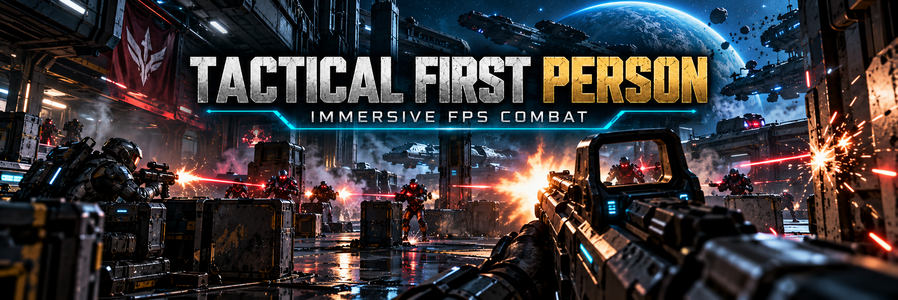

# Tactical First Person — play SpaceBourne 2 on foot in first person

SpaceBourne 2 has a first-person view on foot, but it hides your whole body and throws you
back to third person as soon as you draw a weapon. Tactical First Person keeps you in first
person with a weapon in your hands: you see your own arms, body and gun, you aim by zooming in,
and every shot goes where you look.

Version 0.1.5 · [Nexus Mods page](https://www.nexusmods.com/spacebourne2/mods/15) · UE4SS Lua mod · works alone or with the rest of the
realism set (see below).

## What it does

- **Same key as the game:** press the game's "switch camera" key (or gamepad button) on foot.
  Press it again for third person. Your choice is remembered.
- **First person with weapons:** drawing, switching and firing weapons no longer sends you back
  to third person.
- **Your gun in your hands:** a drawn weapon is held up in front of you, so you see it as in a
  shooter. Sprinting lowers it; it comes back up when you stop.
- **Your own body:** your head, helmet and hair are hidden so they don't block the view; the rest
  stays. Look down and you see your legs and feet.
- **Aiming down the sights:** with an assault rifle, a pulse rifle, a shotgun (the "Pulse
  Charger" included) or a pistol, the right mouse button or the gamepad aim puts your eye
  behind the weapon's own sight: the rifles' front post, the shotguns' red holo, the bullet
  pistol's holo and the laser pistol's red V sight. Other weapons zoom in at your eyes and show
  a small dot in the centre while you aim. Sniper and hunter rifles use the
  game's own scope.
- **No crosshair in first person:** aim with the weapon. While you aim, every reticle is hidden,
  Clear HUD's and the HUD's small blue one included. Hit markers stay.
- **Shots go where you look:** the game already fires from the camera, so there is nothing to
  get used to.
- **Third person when it has to be:** dialogs, melee attacks, falls, the hover pack, space walks
  and cutscenes use the game's camera as before; first person comes back afterwards.
- **On by default.** No extra key.

## Requirements

- SpaceBourne 2 (Steam).
- [UE4SS 3.0.1](https://github.com/UE4SS-RE/RE-UE4SS/releases/tag/v3.0.1), a free script loader
  for Unreal Engine games. Installing HTR or the realism set installer installs it too.

## Install

Option A (recommended): the [SpaceBourne 2 Realism installer](https://www.nexusmods.com/spacebourne2/mods/11).

Option B, manual:

1. Download `TacticalFPS-0.1.5.zip` from the
   [releases](https://github.com/hubertdungen/SpaceBourne2-TacticalFirstPerson/releases).
2. Extract it into the game folder (`...\steamapps\common\SpaceBourne 2\`). It adds
   `SB2\Binaries\Win64\Mods\TacticalFPS\`; the `enabled.txt` inside turns it on.
3. In game, on foot, press the "switch camera" key.

Uninstall: delete `SB2\Binaries\Win64\Mods\TacticalFPS`. The mod never writes to your saves.

## Settings

Edit `Mods\TacticalFPS\scripts\config.lua`, then restart the game. Every line is optional.

- `Enabled`: `false` switches the mod off completely.
- `UseGameCameraKey`: switch with the game's camera key and button (`true`).
- `ToggleKey`: an extra key, none by default. The game's own keys are refused.
- `StartInFirstPerson`: start new sessions in first person (`false`; your last choice wins).
- `Body`: `"Full"` (your body visible) or `"Hidden"` (the game's own look, whole body hidden).
- `HeadShadow`: your hidden head still casts a shadow (`true`).
- `WeaponUp`: hold a drawn weapon up in front of you (`true`). `false` keeps the game's low hold,
  where you only see the gun when you look down.
- `FOV` (90): field of view in first person.
- `NearClip` (5 cm): how close to your eyes things are still drawn; the game uses 10, which cuts
  your collar and the gun's stock. `0` leaves the game's value.
- `ADS.Mode`: `"Sights"` (rifles, shotguns and pistols aim along their sights) or `"Zoom"` (every weapon zooms at your
  eyes). `ADS.ZoomFOV`: zoom per weapon type. `ADS.BlendSeconds` (0.15).
- `AimDot`: small centre dot while zoom-aiming (`true`).
- `Crosshair`: `"Hidden"`, `"Small"` or `"Game"` in first person.

## How it works

The game kept the first-person camera of its animation system, at your eyes. The mod switches
to it when the game's camera key does, hides your head parts instead of your whole body, and
puts first person back each time the game falls back to third person for a weapon. Aiming
narrows the field of view. Details: [DESIGN.md](https://github.com/hubertdungen/SpaceBourne2-TacticalFirstPerson/blob/main/DESIGN.md).

Everything runs on the game thread, from the game's own ticks: the mod uses no UE4SS background
loops (LoopAsync), which can crash UE4SS 3.0.1 when several mods use them at once.

## Status and known limits

<!-- nexus:skip -->
Tested in game on 2026-11-01 (two short runs, details in [DESIGN.md](https://github.com/hubertdungen/SpaceBourne2-TacticalFirstPerson/blob/main/DESIGN.md), section 0.6), with
HTR, Split Controls, Silent Ops, Gear Without Levels, Faction Power, Tactical Engineering, Ammo
Discipline, Get Out of the Way and Ground Waypoints installed:
- the camera key switches first person on and off with a rifle in hand, with the HUD line;
- drawing and switching weapons keeps first person; the pistol and the rifle are held up in view,
  lowered while sprinting; a wall 45 cm ahead: no clipping;
- rifle aiming down the sights: rounds fired at a pillar 3 m away hit where the front post
  pointed; pistol aiming: zoom with the centre dot; the sight view of nine weapon types checked;
- no head, helmet or hair in view; looking down shows hands, gun and feet with no cut edges;
- frame times in first vs third person: the same (9.3–9.9 ms average, no frame over 26 ms);
- your saves untouched.
- the gamepad camera button switches like the key; the hover pack switches to third person and
  first person comes back when you land.
Not yet tried in game: sniper scopes, dialogs, melee and space walks (they follow the game's own
camera code paths). The game froze twice during these
tests, both times while the PC was idle or remote-locked; that is a known issue with the game
running behind a locked screen, not with this mod.

Also tested in game with HTR installed: the view stays at your eyes after a reload; no crash on
death in first person (rifle sights and rifle up, each followed by a load); every reticle hidden
while aiming with the mouse and the gamepad aim; shotguns and both pistols aim with their own
sight mark on the screen centre and the gun straight; aiming costs the same as not aiming;
saves untouched.
<!-- /nexus:skip -->

Known limits:

- **Third-person animations:** the game has no first-person arms or animations. The gun is held
  with its third-person aiming pose, so it sits in the lower part of the view. Only rifles,
  shotguns and pistols get a true sight view; SMGs and the rest zoom with a centre dot.
- **Walls:** standing right against a wall, the barrel goes into it.
- **Big moves:** rolls, climbing over ledges and hit reactions move the camera with your head.
- **Pistol aim flicker:** with the whole realism set installed, the view can flicker for a moment
  when you start aiming a pistol, and can turn quickly when you stop. A fix is being worked on.
- **Ship cockpits** are unchanged: the game has no pilot body to show.

## Part of the SpaceBourne 2 realism set

Part of the realism set, built around [Hardcore Tactical Realism](https://www.nexusmods.com/spacebourne2/mods/4)
as the core mod. HTR is not required: this mod works on its own or with any of the others.
To install them all at once, use the installer:
[SpaceBourne 2 Realism](https://github.com/hubertdungen/SpaceBourne2-Realism)
([Nexus](https://www.nexusmods.com/spacebourne2/mods/11)).

| Mod | Status |
|---|---|
| **Hardcore Tactical Realism (HTR)** — realistic ballistics and tactical AI | released: [GitHub](https://github.com/hubertdungen/SpaceBourne2-HardcoreTacticalRealism) · [Nexus Mods](https://www.nexusmods.com/spacebourne2/mods/4) · [Steam discussion](https://steamcommunity.com/app/1646850/discussions/0/573805072991123580) |
| **Split Controls** — separate invert for ship and on foot | released: [GitHub](https://github.com/hubertdungen/SpaceBourne2-SplitControls) · [Nexus Mods](https://www.nexusmods.com/spacebourne2/mods/5) |
| **Silent Ops** — realistic stealth | released: [GitHub](https://github.com/hubertdungen/SpaceBourne2-SilentOps) · [Nexus Mods](https://www.nexusmods.com/spacebourne2/mods/6) |
| **Gear Without Levels** — use gear regardless of level | released: [GitHub](https://github.com/hubertdungen/SpaceBourne2-GearWithoutLevels) · [Nexus Mods](https://www.nexusmods.com/spacebourne2/mods/7) |
| **SB2 HOTAS** — HOTAS, triple screens, head tracking | released: [GitHub](https://github.com/hubertdungen/SpaceBourne2-HOTAS) · [Nexus Mods](https://www.nexusmods.com/spacebourne2/mods/8) |
| **Faction Power** — your deeds earn your faction power | released: [GitHub](https://github.com/hubertdungen/SpaceBourne2-FactionPower) · [Nexus Mods](https://www.nexusmods.com/spacebourne2/mods/9) |
| **Tactical Engineering** — realistic deployable turrets | released: [GitHub](https://github.com/hubertdungen/SpaceBourne2-TacticalEngineering) · [Nexus Mods](https://www.nexusmods.com/spacebourne2/mods/10) |
| **Ammo Discipline** — realistic ammo limits and scavenging | released: [GitHub](https://github.com/hubertdungen/SpaceBourne2-AmmoDiscipline) · [Nexus Mods](https://www.nexusmods.com/spacebourne2/mods/12) |
| **Ground Waypoints** — planet markers on foot and on the hoverbike | released: [GitHub](https://github.com/hubertdungen/SpaceBourne2-GroundWaypoints) · [Nexus Mods](https://www.nexusmods.com/spacebourne2/mods/13) |
| **Get Out of the Way** — NPCs step aside naturally | released: [GitHub](https://github.com/hubertdungen/SpaceBourne2-GetOutOfTheWay) · [Nexus Mods](https://www.nexusmods.com/spacebourne2/mods/14) |
| **Tactical First Person** — play on foot in first person (this mod) | released: [GitHub](https://github.com/hubertdungen/SpaceBourne2-TacticalFirstPerson) · [Nexus Mods](https://www.nexusmods.com/spacebourne2/mods/15) |

## License

MIT. See [LICENSE](https://github.com/hubertdungen/SpaceBourne2-TacticalFirstPerson/blob/main/LICENSE).
